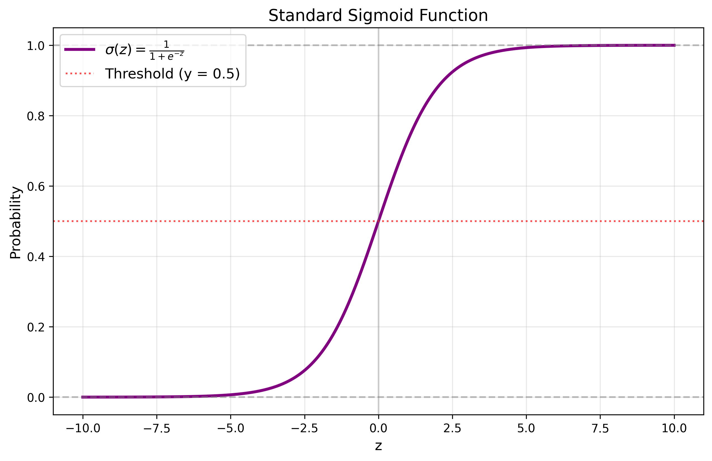
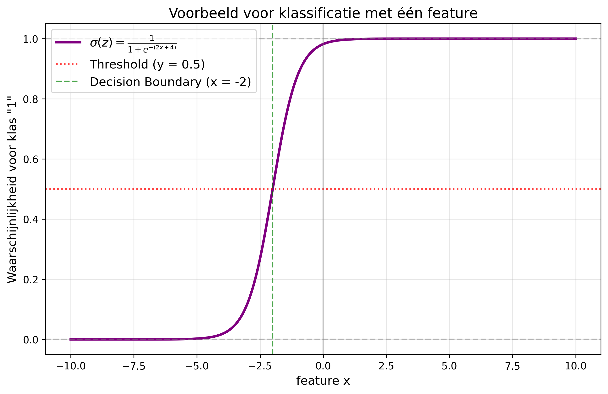
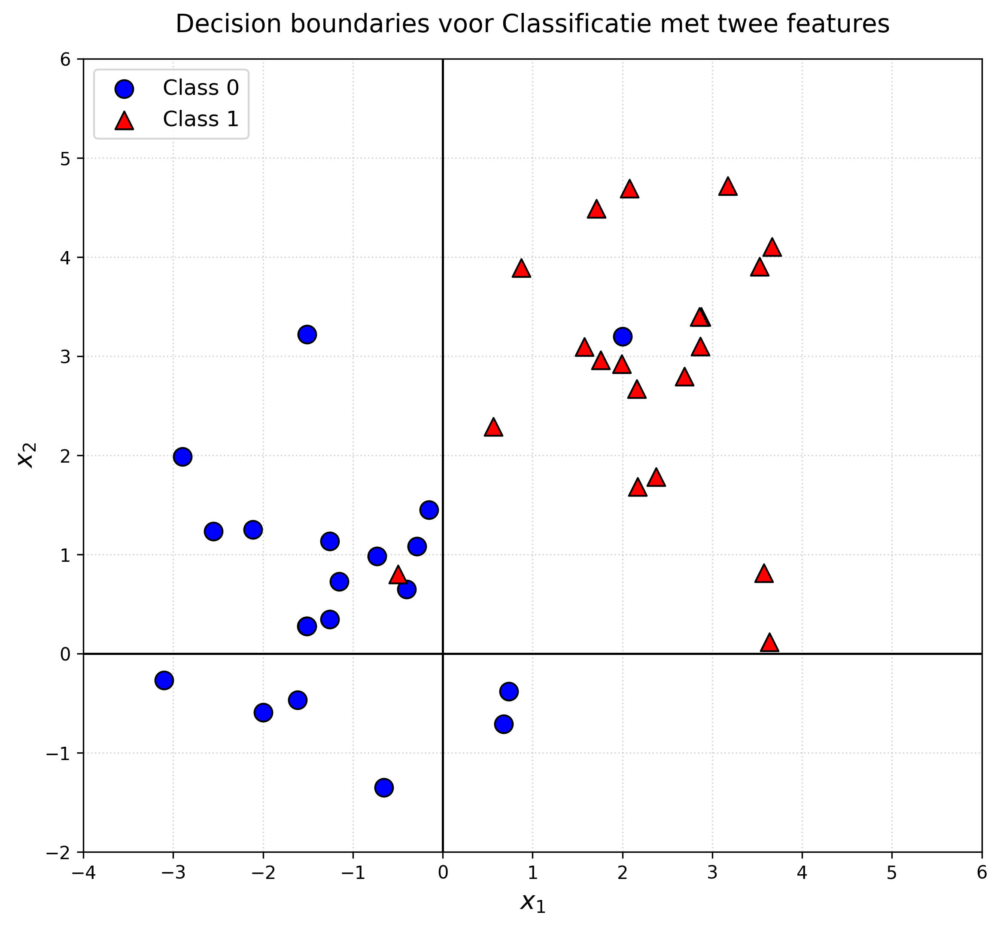
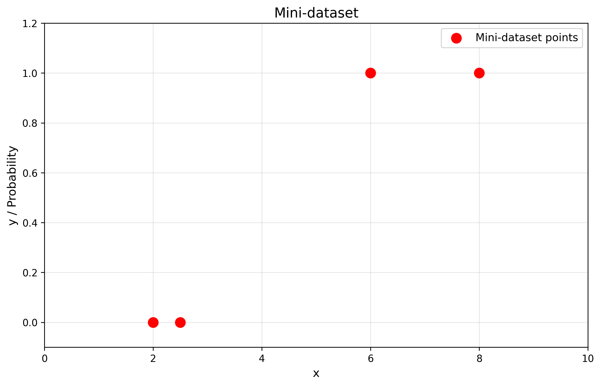
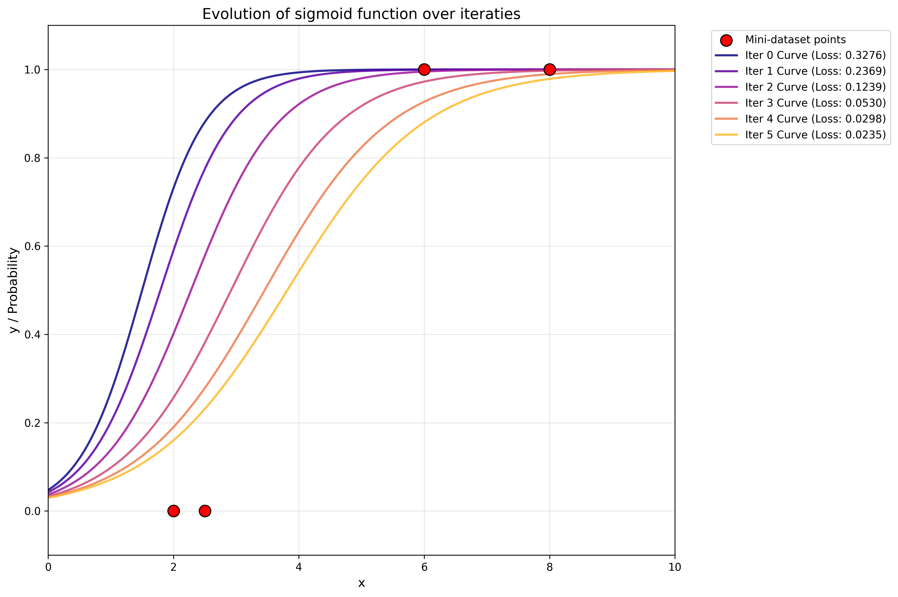
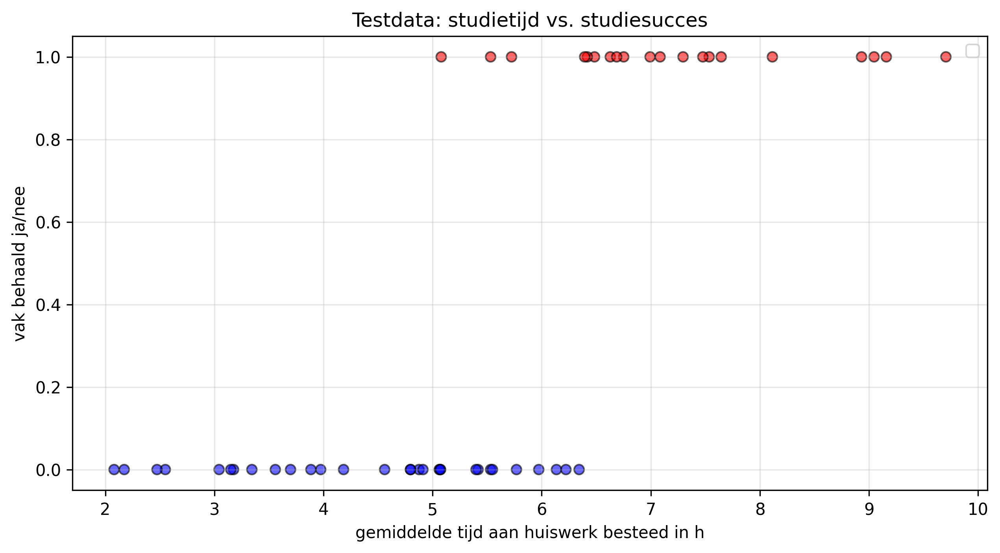

# Oefening classificatie en gradient descent
## Programmeren, AI en Samenleving

**Het docententeam**  
November 2026

## 1. Classificeren met een sigmoidfunctie

### De functie $$\sigma(z)$$

In het hoorcollege hebben we gezien dat we een sigmoidfunctie kunnen gebruiken om classificatie te modelleren. De functie is:

$$
\sigma(z)=\frac{1}{1+e^{-z}}.
$$

In afbeelding 1 zie je de grafiek van deze functie. De rode stippellijn geeft de sigmoidwaarde aan die als omslagpunt voor de classificatie wordt gebruikt.

*Afbeelding 1. De grafiek van de sigmoidfunctie. De rode stippellijn markeert de sigmoidwaarde waarbij de classificatie omslaat.*

Een voordeel van de sigmoidfunctie ten opzichte van een stapfunctie is dat de sigmoidfunctie differentieerbaar is. Daardoor kunnen we ook de verliesfunctie differentiëren. De sigmoidfunctie heeft daarnaast andere nuttige eigenschappen.

We kunnen de functie bijvoorbeeld gebruiken om te voorspellen of een paddenstoel giftig is. Anders dan een stapfunctie neemt de sigmoidfunctie niet alleen de waarden 0 en 1 aan. De functiewaarden liggen in het open interval $$(0,1)$$. De functie maakt een vloeiende overgang van waarden dicht bij 0 naar waarden dicht bij 1. Deze vloeiende overgang maakt de functie differentieerbaar.

We kunnen de sigmoidwaarde omzetten in een classificatie door de volgende beslisregel te gebruiken:

$$
\begin{cases}
1 & \text{als } \sigma(z)\geq 0{,}5,\\
0 & \text{als } \sigma(z)<0{,}5.
\end{cases}
$$

Bij $$z=0$$ geldt $$\sigma(z)=0{,}5$$. Daarom is $$z=0$$ het omslagpunt waarop de voorspelde klasse verandert. Dit punt of deze grens heet de *decision boundary* (beslissingsgrens).

Omdat de sigmoidwaarden tussen 0 en 1 liggen, kunnen we ze interpreteren als modelmatige waarschijnlijkheden. Een kleine sigmoidwaarde duidt op een kleine voorspelde kans om tot klasse 1 te behoren; een grote waarde duidt op een grote voorspelde kans. In de buurt van $$z=0$$ is de sigmoidwaarde ongeveer 0,5, wat overeenkomt met onzekerheid over de klasse. Een stapfunctie kan die onzekerheid rond de beslissingsgrens niet weergeven.

### Classificeren met een sigmoidfunctie

Bij classificatie is $$z$$ in de sigmoidfunctie een lineaire functie van de kenmerken. Stel dat we voorspellingen doen op basis van één kenmerk $$x$$. Dan geldt:

$$
z=wx+b,
$$

waarbij $$w$$ het gewicht (*weight*) en $$b$$ de bias is. Door de waarden van $$w$$ en $$b$$ aan te passen, veranderen we de positie en de steilheid van de sigmoidcurve.

De beslissingsgrens ligt waar:

$$
0=z=wx+b.
$$

Als $$w\neq 0$$, kunnen we dit oplossen naar $$x$$:

$$
x=-\frac{b}{w}.
$$

Als we bijvoorbeeld $$w=2$$ en $$b=4$$ kiezen, is de beslissingsgrens $$x=-2$$. Afbeelding 2 toont de bijbehorende sigmoidcurve voor $$z=2x+4$$. De overgang tussen de klassen is steil en de beslissingsgrens ligt bij $$x=-2$$.

*Afbeelding 2. De sigmoidfunctie voor $$z=2x+4$$. De rode stippellijn markeert de sigmoidwaarde bij het omslagpunt; de groene lijn markeert de beslissingsgrens.*

In het voorbeeld uit het hoorcollege voorspelden we irissoorten op basis van twee kenmerken: *petal width* (kroonbladbreedte) en *petal length* (kroonbladlengte). De lineaire functie waarop we de sigmoidfunctie toepassen, heeft dan de volgende vorm:

$$
z=w_1x_1+w_2x_2+b.
$$

De beslissingsgrens is dan geen enkele waarde voor een kenmerk, maar een lijn in de tweedimensionale ruimte van kenmerken.

### Opgave 1

**i.** Laat zien dat de beslissingsgrens voor

$$
z=w_1x_1+w_2x_2+b
$$

wordt beschreven door de lineaire functie

$$
x_2=-\frac{w_1}{w_2}x_1-\frac{b}{w_2}.
$$

**Tip:** de beslissingsgrens ligt waar $$z=0$$. Neem aan dat $$w_2\neq 0$$.

**ii.** Stel dat de parameters zijn:

$$
w_1=-2,\qquad w_2=1,\qquad b=-1.
$$

Bepaal de beslissingsgrens van deze classificatie en teken deze in afbeelding 3. Wat kun je zeggen over de kwaliteit van de classificatie?

**iii.** Waar zou de beslissingsgrens in afbeelding 3 moeten liggen om de dataset goed te classificeren? Teken de grens in het diagram en bepaal bij benadering de formule voor $$z$$ die bij jouw lijn hoort. Wat kun je zeggen over de loss van jouw model? Kun je voor deze dataset een loss van 0 behalen?

*Afbeelding 3. De dataset voor de classificatieopgave.*

## 2. Gradient descent

Stel dat we de volgende kleine dataset hebben. Voor vier studenten kennen we het gemiddelde aantal uren dat ze per week aan hun huiswerk besteden en of ze het vak halen. De vier datapunten zijn weergegeven in afbeelding 4.

| Datapunt | Huiswerktijd per week (uur), $$x$$ | Vak gehaald, $$y$$ |
| ---: | ---: | ---: |
| 1 | 2 | 0 |
| 2 | 2,5 | 0 |
| 3 | 6 | 1 |
| 4 | 8 | 1 |

*Afbeelding 4. Visualisatie van de dataset.*

We willen een classificatiemodel trainen dat op basis van de wekelijkse huiswerktijd voorspelt of nieuwe studenten het vak halen. Net als in het hoorcollege gebruiken we een lineair model met een sigmoidfunctie. We hebben nu één invoerkenmerk: het gemiddelde aantal uren dat een student per week aan huiswerk besteedt. Ons model heeft daarom twee parameters, $$w$$ en $$b$$:

$$
\hat{y}=\frac{1}{1+e^{-z}},
\qquad z=wx+b.
$$

We willen de waarden van $$w$$ en $$b$$ zo kiezen dat het model de studenten zo goed mogelijk classificeert. Dat is een optimaliseringsprobleem: we zoeken de parameterwaarden waarvoor de fout op de trainingsdata zo klein mogelijk is.

Voor de afleidingen hieronder gebruiken we de **gemiddelde gekwadrateerde fout** (*mean squared error*, MSE):

$$
\mathrm{Loss}(w,b)=\frac{1}{4}\sum_{j=1}^{4}(y_j-\hat{y}_j)^2.
$$

Hierbij is $$j$$ de index van een datapunt, $$y_j$$ de werkelijke klasse en $$\hat{y}_j$$ de voorspelling van het model voor dat datapunt.

Zoals we in het hoorcollege hebben besproken, kunnen we voor een model met een sigmoidfunctie de afgeleiden naar de parameters bepalen. Het resulterende stelsel is echter lastig rechtstreeks naar $$w$$ en $$b$$ op te lossen. Daarom gebruiken we een numerieke methode om de loss te minimaliseren: *gradient descent*.

Bij deze methode beginnen we met een startschatting voor de parameters en passen we die herhaaldelijk aan in de richting waarin de loss afneemt.

### Gradient-descentalgoritme

1. **Initialiseer** $$w$$ en $$b$$.
2. **Herhaal** totdat het minimum voldoende is benaderd:
   $$
   w\leftarrow w-\alpha\frac{\partial\mathrm{Loss}}{\partial w},
   \qquad
   b\leftarrow b-\alpha\frac{\partial\mathrm{Loss}}{\partial b}.
   $$

Hierbij is $$\alpha$$ de leersnelheid (*learning rate*). Deze bepaalt hoe groot de stappen zijn die we zetten. In dit voorbeeld gebruiken we $$\alpha=1$$, zodat de leersnelheid in de updates niet zichtbaar hoeft te worden uitgeschreven.

Voor de gemiddelde gekwadrateerde fout hierboven zijn de partiële afgeleiden:

$$
\frac{\partial\mathrm{Loss}}{\partial w}
=\frac{1}{2}\sum_{j=1}^{4}(\hat{y}_j-y_j)\hat{y}_j(1-\hat{y}_j)x_j,
$$

$$
\frac{\partial\mathrm{Loss}}{\partial b}
=\frac{1}{2}\sum_{j=1}^{4}(\hat{y}_j-y_j)\hat{y}_j(1-\hat{y}_j).
$$

Voor elk datapunt $$j$$ is $$y_j$$ de werkelijke klasse en is $$\hat{y}_j$$ de voorspelling van de sigmoidfunctie:

$$
\hat{y}_j=\frac{1}{1+e^{-z_j}},
\qquad z_j=wx_j+b.
$$

Voor een gegeven keuze van $$w$$ en $$b$$ kunnen we de partiële afgeleiden van de loss met deze dataset berekenen.

### Opgave 2

**i.** Stel dat we beginnen met de parameters $$w=0$$ en $$b=1$$. Bepaal de beslissingsgrens en teken deze in afbeelding 4. Wordt de trainingsdataset met deze grens al goed geclassificeerd?

**ii.** In de tabel hieronder is het gradient-descentalgoritme gedurende vier updates uitgevoerd. Afbeelding 5 toont hoe de sigmoidfunctie zich steeds beter aanpast aan de trainingsdata. Bereken voor de update van iteratie 4 naar iteratie 5 zelf de partiële afgeleiden van de loss naar $$w$$ en $$b$$ en de nieuwe parameterwaarden. Vul de vraagtekens in de tabel in. Bepaal vervolgens de nieuwe beslissingsgrens. Is het model voldoende geoptimaliseerd voor de trainingsdata?

**iii.** Afbeelding 6 toont testdata voor 50 andere studenten: hun wekelijkse huiswerktijd en of ze het vak hebben gehaald. Teken de door jou berekende beslissingsgrens in de afbeelding. Is het model voldoende getraind?

| Iteratie | $$w$$ | $$b$$ | Loss | $$\partial L/\partial w$$ | $$\partial L/\partial b$$ |
| ---: | ---: | ---: | ---: | ---: | ---: |
| 0 | 2,000000 | -3,000000 | 0,327563 | 0,259332 | 0,118106 |
| 1 | 1,740668 | -3,118106 | 0,236912 | 0,311797 | 0,138989 |
| 2 | 1,428871 | -3,257095 | 0,123857 | 0,272651 | 0,118724 |
| 3 | 1,156220 | -3,375819 | 0,052954 | 0,159035 | 0,069038 |
| 4 | 0,997185 | -3,444857 | 0,029778 | ? | ? |
| 5 | ? | ? | — | — | — |

*Afbeelding 5. Ontwikkeling van de sigmoidfunctie tijdens de iteraties.*

*Afbeelding 6. Testdata voor het classificatiemodel.*

## Aandachtspunten bij de oorspronkelijke tekst

- In de oorspronkelijke definitie van de sigmoidfunctie stond $$e^z$$ in de noemer. De rest van het document gebruikt $$e^{-z}$$; hierboven is de gangbare definitie $$\sigma(z)=1/(1+e^{-z})$$ consequent gebruikt.
- De oorspronkelijke formule voor de loss miste onder meer de kwadraten en de datapuntindex. De tabelwaarden voor loss komen overeen met de gemiddelde gekwadrateerde fout $$\frac{1}{4}\sum_j(y_j-\hat{y}_j)^2$$. De oorspronkelijke formules voor de afgeleiden hadden een factor $$\frac{1}{4}$$; voor deze loss hoort daar $$\frac{1}{2}$$ te staan. De formule is hier aangepast zodat loss en afgeleiden wiskundig overeenkomen.
- De startwaarden in onderdeel 2(i), $$w=0$$ en $$b=1$$, verschillen van de beginwaarden in rij 0 van de tabel, $$w=2$$ en $$b=-3$$. Controleer welke startwaarden bedoeld zijn.
- De oorspronkelijke tabel heeft geen waarden voor de loss en afgeleiden in rij 5; die velden zijn als niet gegeven aangeduid.
- De afbeeldingen worden weergegeven als de genoemde afbeeldingsbestanden in dezelfde map als het Markdown-bestand staan.

*De oorspronkelijke tekst noemt in de introductie classificatie als voorbeeld van een waarschijnlijkheidsinterpretatie. Die interpretatie veronderstelt dat de sigmoiduitvoer als geschatte kans wordt gebruikt; ze is niet op zichzelf een garantie dat de voorspellingen goed gekalibreerd zijn.*
