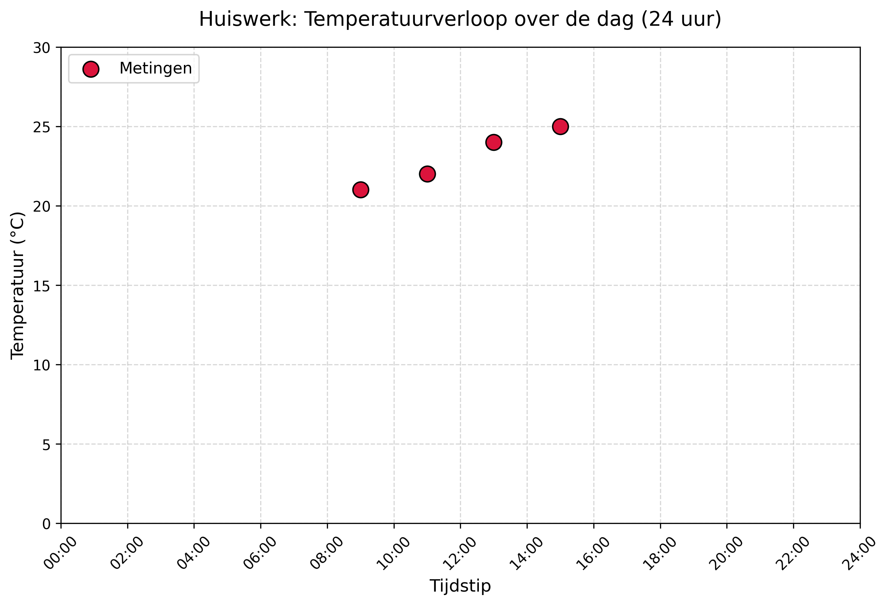

# Voorbereidende opdracht werkcollege 2 (~ *tijd*)

## Modelleren van temperatuur

Stel dat we de volgende dataset hebben: op een dag in de zomer hebben we op vier momenten de buitentemperatuur op Science Park gemeten (Deze dataset is klein gehouden om het rekenwerk eenvoudig te maken).

| Datapunt | Tijd | Gemiddelde temperatuur (°C) |
| --- | --- | --- |
| 1 | 9:00 | 21 |
| 2 | 11:00 | 22 |
| 3 | 13:00 | 24 |
| 4 | 15:00 | 25 |

Op basis van deze data willen we een voorspelling maken voor de temperatuur om 12 uur. Hiervoor gebruiken we lineaire regressie met de *squared error loss function*.

### Opgave 1

Bepaal de optimale waarden voor de parameters $$w$$ en $$b$$, gegeven dat ons model een lineaire functie is:

$$
\hat{y}_1 = wx + b
$$

Bepaal ook de grootte van de fout die dit model maakt: $$\mathrm{Loss}(\hat{y}_1)$$.

Teken vervolgens de resulterende functie in de grafiek in afbeelding 1 en neem die mee naar het werkcollege (op papier, als je die niet hebt kan je die vinden op A4 formaat bij het lesmateriaal). Deze tekening hoef je dus niet online in te leveren.

## Afbeelding 1

*Afbeelding 1: over de dag gemeten buitentemperatuur op Science Park.*

### Opgave 2

Stel dat we de bias $$b$$ weglaten en dus een model van de volgende vorm gebruiken:

$$
\hat{y}_2 = wx
$$

Dit komt erop neer dat we een lineaire functie bepalen die door de oorsprong van het coördinatenstelsel loopt. Bepaal ook hiervoor de optimale parameter $$w$$ en teken de resulterende functie in de grafiek. Bepaal opnieuw de fout die dit model maakt: $$\mathrm{Loss}(\hat{y}_2)$$. Wat valt op?

### Opgave 3

Stel dat we ook een voorspelling willen maken voor een tijdstip later op de dag, bijvoorbeeld 20 uur. Is het gebruikte model dan nog steeds geschikt? Waarom wel of niet? Wat voor model zouden we dan beter kunnen gebruiken?
